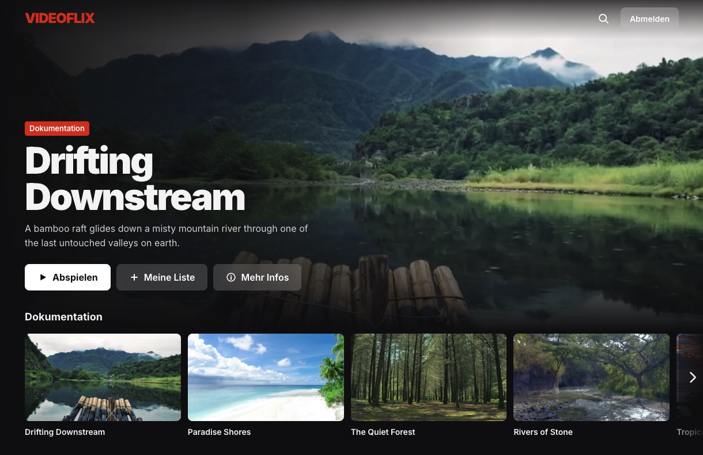
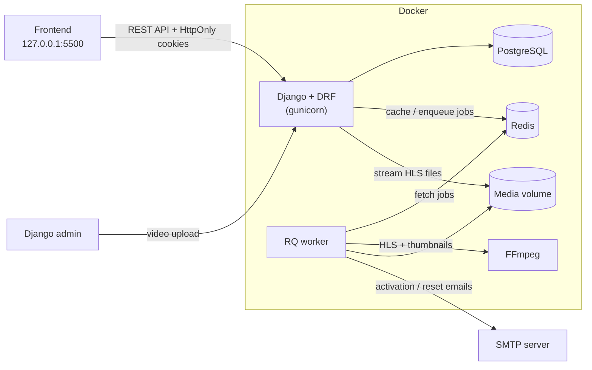

# 🎬 Videoflix Backend

The backend of Videoflix, a small Netflix-style video streaming platform built as a project for the Developer Akademie. Users register, confirm their email and log in, then browse videos grouped by genre and stream them in 480p, 720p or 1080p. Admins upload videos in the Django admin; the backend converts them into HLS streams and thumbnails in the background. Everything runs with a single `docker compose up`.



*The Videoflix frontend (provided by the Developer Akademie) running on this backend.*

## Table of Contents

- [Tech Stack](#tech-stack)
- [Features](#features)
- [Live Demo](#live-demo)
- [Installation](#️-installation)
- [Environment Variables](#environment-variables)
- [Usage](#usage)
- [API Endpoints](#api-endpoints)
- [Architecture](#architecture)
- [Folder Structure](#folder-structure)
- [Tests](#tests)
- [Security Considerations](#security-considerations)
- [Limitations](#limitations)
- [License](#license)

## Tech Stack

| Area | Choice |
|---|---|
| Language & framework | `Python 3.12`, `Django 6.1`, `Django REST Framework` |
| Authentication | `djangorestframework-simplejwt` (JWT in HttpOnly cookies, token blacklist) |
| Database | `PostgreSQL` |
| Cache & job queue | `Redis`, `django-redis`, `django-rq` |
| Video processing | `FFmpeg` (HLS, thumbnails) |
| Server | `gunicorn`, `WhiteNoise` (static files), `django-cors-headers` |
| Infrastructure | `Docker`, `Docker Compose` |

## Features

**Accounts**
- **Registration with email confirmation** — new accounts stay inactive until the link in the activation email is opened.
- **Login with JWT cookies** — access and refresh token are set as HttpOnly cookies, so the frontend never touches the tokens.
- **Token refresh and logout** — expired access tokens are renewed via the refresh cookie; logout blacklists the refresh token and deletes both cookies.
- **Password reset** — reset link by email; setting a new password ends all existing sessions.
- **HTML emails** — activation and reset emails based on the frontend designs, responsive, with an embedded logo and a plain-text fallback.
- **Generic error messages** — login and password reset never reveal whether an email address is registered.

**Videos**
- **Admin upload** — videos are uploaded with title, description and genre in the Django admin.
- **Background conversion** — a Django signal queues an RQ job that converts every upload into HLS streams in 480p, 720p and 1080p.
- **Automatic thumbnails** — a representative frame of the video becomes the thumbnail unless the admin uploads one; if the admin removes it later, a new one is generated. Replaced thumbnails are deleted from disk.
- **Processing status** — `pending` → `processing` → `ready` / `failed`; only ready videos are listed.
- **HLS streaming** — playlists and segments are delivered through authenticated API endpoints.
- **Cleanup** — deleting a video removes its original file, thumbnail and all HLS files.

**Under the hood**
- **Redis cache** — the video list is cached and invalidated whenever a video is added, changed or deleted.
- **Tests** — 99 automated tests for all endpoints, the background jobs and the media access rules.

## Live Demo

There is no public demo: video conversion needs real server resources, so the project is meant to run locally with Docker (see [Installation](#️-installation)).

## ⚙️ Installation

**Prerequisites**
- [Docker Desktop](https://www.docker.com/products/docker-desktop/) (includes Docker Compose), running
- Git (on Windows, use Git Bash for the commands below)

1. Clone the repository:
   ```bash
   git clone https://github.com/lvfranek/videoflix-backend.git
   cd videoflix-backend
   ```
2. Create your environment file and adjust the values if needed (see [Environment Variables](#environment-variables)):
   ```bash
   cp .env.template .env
   ```
3. Build and start the containers (database, Redis and backend):
   ```bash
   docker compose up --build
   ```
4. Open the Django admin at [http://localhost:8000/admin/](http://localhost:8000/admin/) and log in with `DJANGO_SUPERUSER_USERNAME` / `DJANGO_SUPERUSER_PASSWORD` from your `.env`. The superuser is created automatically on the first start.
5. Upload a few videos (see [Usage](#usage)) and start the frontend on `http://127.0.0.1:5500`.

Migrations, static files and the superuser are handled automatically by `backend.entrypoint.sh` on every start.

## Environment Variables

All variables live in `.env` (copied from `.env.template`). Keep the variable names; only change the values.

| Variable | Description | Required |
|---|---|---|
| `DJANGO_SUPERUSER_USERNAME` | Username of the admin account created on startup | Yes |
| `DJANGO_SUPERUSER_PASSWORD` | Password of the admin account | Yes |
| `DJANGO_SUPERUSER_EMAIL` | Email of the admin account (also used for the frontend login) | Yes |
| `SECRET_KEY` | Django secret key — generate your own, don't use `$` in the value | Yes |
| `DEBUG` | `True` for local development, `False` in production | Yes |
| `ALLOWED_HOSTS` | Comma-separated hosts the backend answers to | Yes |
| `CSRF_TRUSTED_ORIGINS` | Comma-separated frontend origins; also used as allowed CORS origins | Yes |
| `DB_NAME`, `DB_USER`, `DB_PASSWORD` | PostgreSQL credentials (the database is created with these values) | Yes |
| `DB_HOST`, `DB_PORT` | PostgreSQL host and port (`db`, `5432` inside Docker) | Yes |
| `REDIS_LOCATION` | Redis URL for the cache | Yes |
| `REDIS_HOST`, `REDIS_PORT`, `REDIS_DB` | Redis connection for the RQ job queue | Yes |
| `EMAIL_HOST` | SMTP server; leave `smtp.example.com` to print emails to the console instead | No |
| `EMAIL_PORT`, `EMAIL_USE_TLS`, `EMAIL_USE_SSL` | SMTP port and encryption | No |
| `EMAIL_HOST_USER`, `EMAIL_HOST_PASSWORD` | SMTP login (e.g. a Gmail address and an app password) | No |
| `DEFAULT_FROM_EMAIL` | Sender of all emails, e.g. `"Videoflix <you@example.com>"` | No |
| `FRONTEND_URL` | Base URL of the frontend, used for links in emails | Yes |

After changing `.env`, recreate the backend container: `docker compose up -d --force-recreate web`.

## Usage

**Upload videos**
1. Open [http://localhost:8000/admin/](http://localhost:8000/admin/) → **Videos** → **Add video**.
2. Enter title, description and genre, choose a video file (`mp4`, `mov`, `mkv`, `webm` or `avi`) and save. Leave the thumbnail empty to generate it automatically.
3. Reload the list after a few seconds: the status changes from `pending` to `ready` once all resolutions are converted (roughly half of the video's length).

The most recently uploaded video is shown as the hero video in the frontend.

**Connect the frontend**
Serve the Videoflix frontend (e.g. with the VS Code *Live Server* extension) and open it via `http://127.0.0.1:5500` — not `localhost`, otherwise the auth cookies are not sent. The frontend expects the API at `http://127.0.0.1:8000/api/`.

**Emails**
With the placeholder `EMAIL_HOST=smtp.example.com`, activation and reset emails are printed to the backend logs, links included. Enter real SMTP data in `.env` to send them for real.

**Useful commands**

| Command | What it does |
|---|---|
| `docker compose up -d` | Start all containers in the background |
| `docker compose logs -f web` | Follow the backend logs (requests, jobs, console emails) |
| `docker compose exec web python manage.py test` | Run the test suite |
| `docker compose exec web python manage.py makemigrations` | Create migrations after model changes |
| `docker compose exec web python manage.py migrate` | Apply migrations |
| `docker compose up --build -d` | Rebuild after changing `requirements.txt` |
| `docker compose down` | Stop the containers (data is kept) |
| `docker compose down -v` | Stop the containers and delete all data, including uploaded videos |

## API Endpoints

All endpoints live under `/api/`. Authentication works with the HttpOnly cookies set by the login.

| Method | Endpoint | Auth | Description |
|---|---|---|---|
| `POST` | `/api/register/` | – | Create an inactive account and send the activation email |
| `GET` | `/api/activate/<uidb64>/<token>/` | – | Activate the account from the email link |
| `POST` | `/api/login/` | – | Log in and set the `access_token` and `refresh_token` cookies |
| `POST` | `/api/logout/` | Refresh cookie | Blacklist the refresh token and delete both cookies |
| `POST` | `/api/token/refresh/` | Refresh cookie | Set a new `access_token` cookie |
| `POST` | `/api/password_reset/` | – | Send a password reset email (always answers `200`) |
| `POST` | `/api/password_confirm/<uidb64>/<token>/` | – | Set a new password from the email link |
| `GET` | `/api/video/` | Access cookie | List all ready videos, newest first |
| `GET` | `/api/video/<movie_id>/<resolution>/index.m3u8` | Access cookie | HLS playlist (`480p`, `720p` or `1080p`) |
| `GET` | `/api/video/<movie_id>/<resolution>/<segment>/` | Access cookie | HLS video segment, e.g. `000.ts` |

## Architecture



- **Web** answers all API requests and the admin. Slow work is never done inside a request.
- **Redis** is both the cache for the video list and the queue for background jobs.
- **RQ worker** (started in the same container) sends emails and converts videos with FFmpeg.
- **Media volume** stores originals, thumbnails and HLS files. Only thumbnails are public; video files are only reachable through the authenticated API.

## Folder Structure

```
├── auth_app/                # Custom user model, registration, login, password reset
│   ├── api/                 # Serializers, views and URLs of the auth endpoints
│   ├── templates/           # HTML and text email templates
│   ├── authentication.py    # JWT authentication via the access_token cookie
│   ├── tasks.py             # Background jobs: activation and reset emails
│   ├── utils.py             # Tokens, cookies and email helpers
│   └── tests/
├── video_app/               # Video model, upload processing and streaming
│   ├── api/                 # Video list and HLS endpoints
│   ├── signals.py           # Start processing on upload, clean up on delete
│   ├── tasks.py             # Background job: thumbnail + HLS conversion
│   ├── utils.py             # FFmpeg, file and cache helpers
│   └── tests/
├── core/                    # Django settings and root URLs
├── docs/                    # Screenshot for this README
├── gunicorn.conf.py         # Threaded gunicorn workers, longer timeout for uploads
├── backend.Dockerfile       # Backend image (Python, FFmpeg)
├── backend.entrypoint.sh    # Migrations, superuser, RQ worker and gunicorn on startup
└── docker-compose.yml       # Backend, PostgreSQL and Redis services
```

## Tests

99 tests cover every endpoint (status codes and response bodies as documented), the cookie authentication, the email contents, the background jobs, the admin thumbnail handling, the file cleanup, the cache and the media access rules. FFmpeg is mocked in most tests; two integration tests convert a tiny generated video with the real FFmpeg. Tests use a temporary media folder and an in-memory cache, so they never touch uploaded videos.

```bash
docker compose exec web python manage.py test
```

## Security Considerations

- **HttpOnly cookies** — JWTs are not readable by JavaScript; cookies use `SameSite=Lax` and become `Secure` when `DEBUG=False`.
- **Token blacklist** — logout and password reset invalidate refresh tokens.
- **No user enumeration** — identical answers (and response times) for unknown emails and wrong passwords; the password reset endpoint always answers `200` and looks up the user only in the background job.
- **Single-use links** — activation and reset links expire after 24 hours and stop working once used.
- **Protected media** — only thumbnails are served publicly; originals and HLS files require a valid access token.
- **Strict file handling** — HLS requests only accept known resolutions and segment names, which prevents path traversal.
- **CORS** — only the origins in `CSRF_TRUSTED_ORIGINS` may send credentialed requests.
- **Secrets** — all credentials come from `.env`, which is excluded from Git and from the Docker image.

## Limitations

- **Admin-only uploads** — users watch videos; only admins can upload them.
- **Fixed video file** — the file of an existing video cannot be replaced; upload a new entry instead.
- **Sequential processing** — one RQ worker converts videos one after another, so many uploads at once take a while.
- **Media served by Django** — fine for this project; a production setup would serve media through a web server or CDN.
- **No public deployment** — the Docker setup targets local development (`DEBUG=True`, gunicorn auto-reload).

## License

All rights reserved — see [LICENSE](LICENSE). The Docker setup, the Videoflix logo, the email designs and the frontend shown in the screenshot are course material of Developer Akademie GmbH and remain their property.
